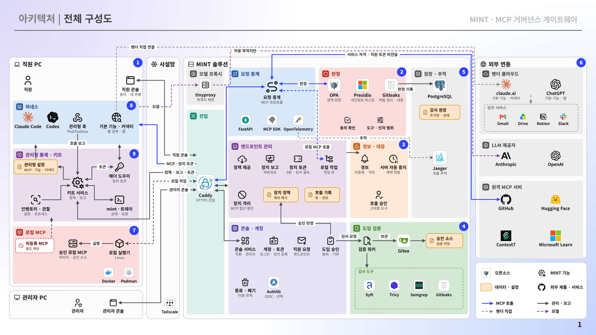

# MINT 사용자 안내서

MINT는 회사가 승인한 MCP를 직원의 AI 코딩 에이전트에 연결하고, 게이트웨이를 지나는 도구 호출의 허용 여부와 실행 결과를 기록합니다. 이 안내서는 한국어 콘솔의 메뉴 이름을 기준으로, 직원과 관리자가 실제로 하는 일을 설명합니다.

실제 콘솔 화면을 먼저 보고 싶다면 [화면으로 둘러보기](screenshots.md)를 엽니다.

## 필요한 안내 찾기

| 안내 | 대상 | 할 수 있는 일 |
| --- | --- | --- |
| [처음 시작하기](getting-started.md) | 직원·관리자 | 계정 준비, 로그인, PC 연결, 첫 사용 확인 |
| [직원 사용 안내](employee.md) | 직원·협력업체 직원 | 사용 가능한 MCP 찾기, 도구 이용 동의, 호출 결과 확인 |
| [관리자 운영 안내](administrator.md) | 관리자 | 호출 승인, 계정과 엔드포인트 관리 |
| [MCP 도입과 연결 관리](mcp-onboarding.md) | 신청자·관리자 | 도입 신청, 검증 보고서 검토, 사용 대상과 연결 통제 |
| [호출 기록과 감사 증빙](call-records.md) | 직원·관리자 | 호출 검색, 판정·실행·응답 구분, 증빙 내보내기 |
| [보안 관제와 정책 확인](security-operations.md) | 관리자 | 경보 확인, 공급망 영향 조회, 관제 전달 상태와 정책 확인 |
| [종료 및 폐기](termination.md) | 관리자 | 이용 종료, 자격 회수, 증거 수집과 종료 판정 |
| [문제 해결](troubleshooting.md) | 직원·관리자 | 로그인·설치·승인·호출 문제의 확인 순서 |

서버를 처음 설치하는 운영자는 [서버 설치와 운영](../../deploy/README.md)을 먼저 읽습니다. 운영체제별 설치·제거 명령은 [직원 PC 키트](../../endpoint-agent/README.md), 선택적인 외부 게이트웨이 연결은 [LiteLLM 연동](../../addons/litellm/README.md)에 있습니다.

## 직원의 기본 사용 흐름

사용할 MCP가 목록에 없으면 **도입 신청**에서 신청합니다. 승인된 MCP도 사용자·도구·대상·기한에 따라 호출이 제한될 수 있습니다.

## 승인과 동의의 차이

| 구분 | 무엇을 결정하나 | 누가 처리하나 | 위치 |
| --- | --- | --- | --- |
| MCP 도입 승인 | 이 서버의 어떤 도구를 누가, 언제까지 사용할 수 있는가 | 관리자. 기본은 신청자와 다른 관리자 | 도입 관리 |
| 도구 이용 동의 | 표시된 목적·입력·외부 목적지에 따른 도구 이용에 동의하는가 | 해당 사용자 | 도구 이용 동의 |
| 개별 호출 승인 | 승인 대기 중인 특정 호출을 실행할 것인가 | 기본은 요청자와 다른 관리자 | 대시보드 → 호출 승인 |

도입 승인이 모든 호출의 허용을 뜻하지는 않습니다. 사용자 동의만으로 조직 정책이나 관리자의 승인을 대신할 수도 없습니다. 개별 호출의 **승인·실행**은 실제 실행으로 이어지는 조작입니다.

## 콘솔 메뉴 지도

| 메뉴 | 직원·협력업체 직원 | 관리자 |
| --- | --- | --- |
| 대시보드 | — | 처리할 일, 호출 승인, 실행 결과 확인, 성능 |
| 호출 기록 | 자신의 호출과 결과 | 조직의 호출, 분석, 엔드포인트 도구 기록, 감사 증빙 |
| 보안 관제 | — | 경보, 사고 보고 증빙, 관제 연동 상태 |
| AI 연결 관리 | — | MCP 서버·도구·접근 권한·연결 통제·커넥터 |
| 사용자 관리 | — | 계정, 초대, 가입 요청, 이용 중지 |
| 엔드포인트 관리 | — | PC 활성화·등록 해제, 통제 점검, 발견 항목 |
| 보안 관리 정책 | — | 보안 정책·통제 규칙과 실제 로드 상태 |
| 도입 신청 / 도입 관리 | 자신의 신청과 사용 가능한 MCP | 신청 검토·승인, 엔드포인트 요청 |
| 종료 및 폐기 | — | 이용 관계 종료와 회수 증거·판정 |
| 도구 이용 동의 | 자신의 동의와 이력 | 자신의 동의와 이력 |

**PC 연결 설정**과 **사내 저장소**는 환경에 따라 바로가기에 표시됩니다. 상단에는 언어 전환, 화면 테마, 비밀번호 변경, 로그아웃이 있습니다. 표시되는 메뉴와 데이터는 로그인한 계정의 역할에 따릅니다.

## 연결 구성과 통제 범위

구성도의 추적 수집기(Jaeger)는 기본 운영 묶음에 포함되지 않는 선택 구성요소입니다. 외부 추적 수집기 연결은 [서버 운영 설정](../../deploy/README.md)을 봅니다.

게이트웨이의 판정은 게이트웨이를 지나는 호출에 적용됩니다. 콘솔의 **연결 통제 현황**에서는 엔드포인트·벤더가 통제하는 연결과 관찰만 가능한 연결도 구분합니다. 간편 모드에서는 PC의 다른 프로그램이 외부에 직접 연결하는 것까지 모두 막지는 않으므로, 조직의 PC·네트워크 통제와 함께 운영합니다.

## 이 안내서의 기준과 문서 이력

이 안내서는 제품 `1.0.0`의 공개 코드와 메뉴를 기준으로 작성했습니다. 설치 환경, 역할, 등록된 서버에 따라 표시 항목이 달라집니다. 기능 설명은 모든 운영체제·MCP 조합에 대한 실행 시험 결과를 뜻하지 않습니다.

제품 판본은 [VERSION](../../VERSION), 출시 변경은 [변경 기록](../../CHANGELOG.md)에서 확인합니다. 문서 보완은 Git 커밋·PR 이력으로 관리하며 문서만 바뀌었다고 제품 판본이나 기존 출시 태그를 바꾸지 않습니다. 자세한 기준은 [버전과 태그 관리](../RELEASING.md)를 봅니다.
