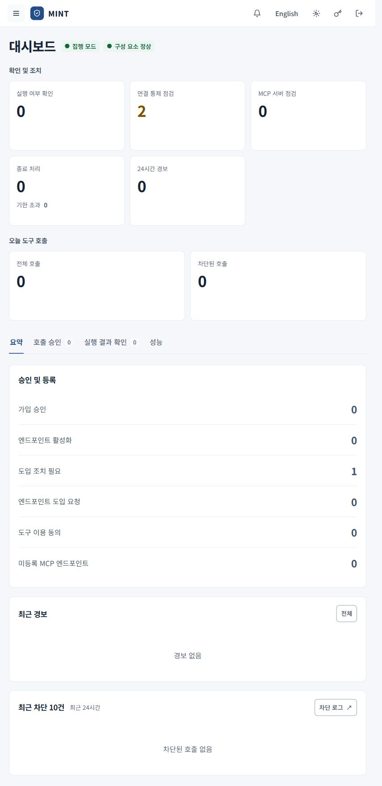
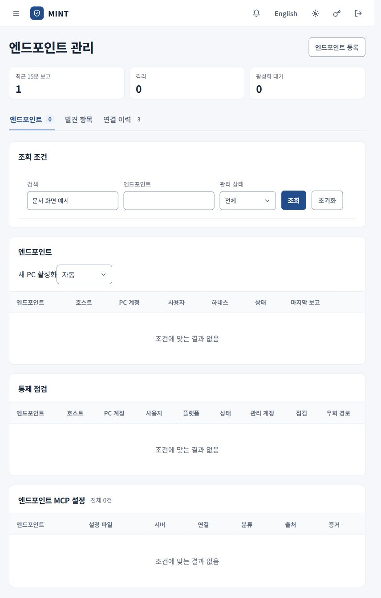

# 관리자 운영 안내

[안내서 홈](README.md) · [MCP 도입과 연결 관리](mcp-onboarding.md) · [보안 관제](security-operations.md)

관리자는 계정과 PC를 준비하고, MCP 도입과 개별 호출을 검토하며, 호출 결과와 보안 상태를 확인합니다. 서버 설치·재기동·백업 같은 작업은 [서버 운영 문서](../../deploy/README.md)에 있습니다.

처리할 일과 호출 현황을 모아 보는 대시보드입니다. 수치는 촬영 시점의 값입니다.

## 처음 운영할 때

1. 서버 설치 문서에 따라 최초 관리자 로그인을 마치고 초기 비밀번호를 변경합니다.
2. 기본 독립 승인으로 운영하려면 신청자와 다른 관리자가 검토할 수 있도록 관리자 계정을 준비합니다. 관리자 계정 생성은 서버의 `deploy/`에서 `./mint.sh add-account <아이디> --role 관리자`로 할 수 있습니다.
3. **사용자 관리**에서 직원 초대 또는 가입 요청을 처리합니다.
4. 직원이 PC 키트를 설치하면 **엔드포인트 관리**에서 상태와 활성화를 확인합니다.
5. **도입 관리**에서 필요한 MCP를 심사하고 사용 대상을 정합니다.
6. **보안 관리 정책**에서 집행 모드와 정책 로드 상태를 확인합니다.

## 대시보드에서 처리할 일 확인

| 탭 | 확인·처리하는 일 |
| --- | --- |
| 요약 | 가입·엔드포인트·동의 등 처리할 일, 최근 경보, 차단 호출을 확인합니다. |
| 호출 승인 | 승인 대기 요청을 검토하고 승인·실행하거나 거부합니다. 처리 이력도 확인합니다. |
| 실행 결과 확인 | 전송 이후 실행 여부가 확정되지 않은 호출을 확인하고 결과를 기록합니다. |
| 성능 | 게이트웨이 처리 시간과 엔드포인트 연결 품질 등 제공되는 지표를 확인합니다. |

### 호출 승인 처리

1. **대시보드 → 호출 승인 → 승인 대기**에서 **검토**를 누릅니다.
2. 요청자, 서버·도구, 대상과 인자, 승인 사유, 만료 시각을 확인합니다.
3. 중대 영향 호출은 설명 증빙의 영향 영역·요청 범위·정책 근거를 확인합니다.
4. 적절하면 **승인·실행**, 부적절하면 **거부**를 선택합니다.
5. **처리 이력**과 **호출 기록**에서 최종 판정·실행·응답을 확인합니다.

**승인·실행**은 보류 중인 호출을 실행하는 조작입니다. 콘솔에서 본인 요청에는 승인 버튼이 제공되지 않으므로 다른 관리자에게 검토를 요청합니다. 승인 시점에도 상태가 달라졌다면 요청이 거절될 수 있으므로 화면에 나온 결과를 확인합니다.

중대 영향 호출의 처리 이력에는 조건에 따라 **승인 번복**이 표시됩니다. 이 기능은 이미 실행된 작업의 효과를 되돌리지 않습니다. 결정 증빙과 개입 이력을 함께 확인합니다.

### 실행 결과가 미확인인 호출

**실행 결과 확인**에서 해당 도구의 실제 처리 결과를 외부 시스템과 대조한 뒤 **실행됨** 또는 **실행 안 됨**을 선택하고 확인 내용을 남깁니다. 이 조작은 확인한 결과를 기록하는 절차입니다. 같은 쓰기·실행 요청을 다시 보내기 전에 사용합니다.

## 사용자 관리

**사용자 관리 → 사용자**에서 이름·이메일·부서로 검색하고 행의 추가 메뉴로 작업합니다.

| 작업 | 사용 시점과 영향 |
| --- | --- |
| 사용자 초대 | 아이디와 부서를 입력해 1회용 초대 링크를 만듭니다. 표시된 만료 시각 안에 해당 직원이 가입합니다. |
| 가입 요청 | 대기 요청의 신원을 확인하고 승인 또는 거부합니다. |
| 상태 변경 | 계정을 사용·중지·잠김 상태로 관리합니다. |
| MCP 이용 중지 | 특정 사용자의 특정 서버 이용을 중지합니다. |
| 전체 중지 / 전체 재개 | 해당 사용자의 MCP 이용을 전체 범위로 중지·재개합니다. |
| 아이디 변경 | 해당 계정의 로그인 아이디를 변경합니다. |
| 비밀번호 재설정 | 다른 계정의 비밀번호를 재설정합니다. 관리자 계정은 `root`만 재설정할 수 있습니다. |
| 삭제 / 복구 | 삭제한 계정은 **삭제된 사용자**에서 확인하고 복구할 수 있습니다. |

관리자 계정의 아이디 변경도 `root`만 할 수 있습니다. 자신의 비밀번호는 상단 **비밀번호 변경**에서 바꿉니다. 본인 계정의 중지·삭제처럼 운영 권한을 잃을 수 있는 조작은 사용자 목록에서 제한됩니다.

**이용 중지** 탭에서 서버별 중지 사유, 중지 시각, 해제 예정과 재개 상태를 확인합니다. 계정 상태 변경, MCP 이용 중지, 서버 이용 관계 종료는 서로 범위가 다른 작업입니다. 영구적인 이용 관계 정리는 [종료 및 폐기](termination.md)를 사용합니다.

SSO를 구성한 환경에만 **SSO** 탭이 표시됩니다. 계정 연결·해제 방법과 제공자 설정은 조직의 로그인 운영 기준에 맞춰 관리합니다.

## 엔드포인트 관리

기기 식별정보를 노출하지 않도록 검색 조건을 적용한 조회 화면입니다. 목록의 0건은 검색 결과이며 전체 등록 기기 수를 뜻하지 않습니다.

### 설치된 PC 활성화

1. **엔드포인트 관리 → 엔드포인트**에서 사용자·호스트·엔드포인트로 검색합니다.
2. PC 사용자와 소유자가 맞는지, 설치 점검과 정책 정보가 보고되었는지 확인합니다.
3. **활성화 대기** 또는 **격리** 상태에서 **활성화**가 표시되면 검토 후 활성화합니다.
4. 마지막 보고 시각과 **통제 점검**의 상태·우회 경로를 확인합니다.

**새 PC 활성화** 설정은 **자동**과 **관리자 확인** 중 선택합니다. 자동 설정이어도 설치 점검이 필요하며, 격리 계정과 macOS는 관리자 활성화가 필요합니다.

### 연결 상태와 발견 항목 확인

- **엔드포인트**: 등록된 PC, 관리 상태, 마지막 보고, 관리형 MCP 설정과 통제 점검을 확인합니다.
- **발견 항목**: 미등록 MCP 설정, 수신기 관측, 엔드포인트에서 차단한 기록을 확인합니다.
- **연결 이력**: 설치 보고·활성화·정책 변경 등 보고된 연결 이력을 확인합니다.

관찰 항목은 보고 시점과 수집 범위가 있습니다. 보고가 오래됐거나 수집에 실패했다면 현재 상태를 다시 확인합니다. PC 보고만으로 장치 전체의 안전이나 우회 불가능성을 보장하지는 않습니다.

### PC 교체·퇴사·제거

해당 PC의 **등록 해제**로 장치 자격을 철회하고 직원에게 로컬 키트 제거를 안내합니다. 등록 해제와 로컬 제거를 모두 처리합니다. 계정 중지·MCP 이용 중지나 이용 관계 종료가 필요한지는 업무 범위에 맞게 별도로 판단합니다.

## 매일 확인할 순서

1. 대시보드에서 처리할 요청과 실행 미확인 호출을 확인합니다.
2. **보안 관제 → 경보**에서 사유와 관련 대상을 확인합니다.
3. **AI 연결 관리**에서 계약 변경·연결 오류·기한 만료 등 점검할 서버를 확인합니다.
4. **엔드포인트 관리**에서 보고가 끊긴 PC와 미등록 MCP를 확인합니다.
5. **종료 및 폐기 → 종료 처리**에서 조치 필요·기한 초과 항목을 확인합니다.

호출 증빙 보관은 [호출 기록과 감사 증빙](call-records.md), 선택적인 관제 전달은 [보안 관제](security-operations.md)를 따릅니다.
