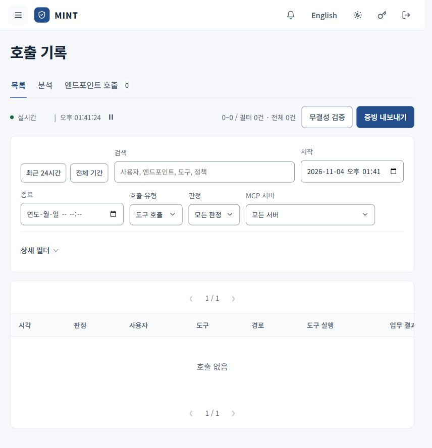

# 호출 기록과 감사 증빙

[안내서 홈](README.md) · [직원 사용 안내](employee.md) · [보안 관제](security-operations.md)

호출 기록에서는 **정책 판정**, **실제 도구 실행**, **응답 처리**를 따로 읽습니다. 직원은 자신의 호출을 확인하고, 관리자는 조직의 호출과 감사 증빙을 확인합니다.

## 원하는 호출 찾기

관리자 조회 화면입니다. 촬영 시점의 최근 24시간 조회 결과는 0건이며, 직원에게는 자신의 호출 범위가 표시됩니다.

1. **호출 기록 → 목록**을 엽니다. 기본 조회는 최근 24시간의 도구 호출입니다.
2. **검색**, 시작·종료 시각, 호출 유형, 판정과 MCP 서버를 설정합니다.
3. 필요한 경우 **상세 필터**에서 실행 결과·엔드포인트·정책·추적 ID를 지정합니다. 관리자는 사용자 필터도 사용합니다.
4. 오래된 기록은 **전체 기간** 또는 시작 시각을 조정해 찾습니다.
5. 호출 행을 열어 상세 탭을 확인합니다.

실시간 목록은 갱신되므로 상세를 비교할 때 **일시정지**를 사용할 수 있습니다. 다시 보려면 **실시간 재개**를 선택합니다. 실시간 표시나 조회에 실패했을 때는 마지막 갱신 상태도 확인합니다.

호출이 보이지 않으면 호출 유형을 **도구 호출 / MCP 연결 / 전체**로 바꿔 확인합니다. 도구에 도달하기 전의 연결 거부는 MCP 연결 기록으로 나타날 수 있습니다.

## 상세 탭 읽기

| 탭 | 확인할 내용 |
| --- | --- |
| 요약 | 호출이 어느 단계에서 처리되었는지 흐름으로 확인합니다. |
| 요청 정보 | 사용자, 엔드포인트, 하네스, 서버·도구와 대상을 확인합니다. |
| 판정 | 사유, 적용 정책, 행위·데이터 등급, 함께 적용된 정책과 승인 요청을 확인합니다. |
| 실행 결과 | MCP 서버 전송, 실제 도구 실행, 응답 처리·마스킹·오류를 확인합니다. |
| 처리 시간 | 단계별 처리 시간을 확인합니다. |
| 연관 이벤트 | 관리자가 관련 엔드포인트·설정·전송 기록을 함께 확인합니다. |

실행 결과의 **추적 정보**에서 추적 ID와 응답·감사 해시 등 제공되는 값을 확인할 수 있습니다. 관리자에게 문제를 전달할 때 호출 번호나 추적 ID를 함께 전달하면 같은 사건을 찾기 쉽습니다. 관리자는 도구 호출의 추적 ID를 눌러 새 탭의 추적 화면에서 게이트웨이 안의 처리 단계와 단계별 소요 시간을 확인할 수 있습니다. 추적 정보는 게이트웨이를 다시 시작하면 비워지므로, 오래된 호출은 이 화면의 기록으로 확인합니다.

## 판정과 실행 결과 구분

| 판정 | 읽는 방법 |
| --- | --- |
| 허용 | 정책이 호출을 허용했습니다. 실제 실행 성공 여부는 실행 결과를 확인합니다. |
| 경보 | 주의할 사유가 기록되었습니다. 차단 여부와 실행 결과를 함께 확인합니다. |
| 제한 실행 | 제한 조건이 적용된 판정입니다. 응답 처리와 적용 사유를 확인합니다. |
| 승인 대기 | 관리자 검토가 필요한 호출입니다. 승인 처리 이후의 결과를 확인합니다. |
| 차단 | 거부된 단계와 사유를 확인합니다. 응답 검사 단계의 차단일 수 있으므로 도구 실행 여부도 확인합니다. |

| 실행·응답 표시 | 의미와 후속 조치 |
| --- | --- |
| 실행 안 함 / 전송 안 함 | 기록상 도구 실행 또는 MCP 서버 전송이 이루어지지 않았습니다. |
| 실행됨 | 도구가 실행되었습니다. 응답 처리까지 함께 확인합니다. |
| 실행 미확인 | 전송 뒤 실제 실행을 확정하지 못했습니다. 외부 시스템의 결과와 대조합니다. |
| 응답 반환 | 응답이 반환되었습니다. |
| 마스킹 반환 | 탐지된 항목을 가린 응답이 반환되었습니다. |
| 응답 보류 | 응답을 안전하게 반환하지 못했습니다. 도구는 이미 실행되었을 수 있습니다. |

예를 들어 쓰기 도구가 실행된 뒤 응답 검사에 실패하면 **실행됨 + 응답 보류**가 함께 나타날 수 있습니다. 결과를 받지 못했다고 같은 쓰기를 반복하지 말고 실제 반영 여부를 먼저 확인합니다.

## 분석과 엔드포인트 기록

**분석** 탭에서는 조회 조건에 해당하는 호출 추이, 서버별 판정과 응답 처리를 확인합니다. 관리자는 정책·엔드포인트·사용자별 분석도 확인합니다. 조회 기간과 필터를 맞춰 비교합니다.

관리자에게 제공되는 **엔드포인트 호출** 탭은 PC가 보고한 도구 기록입니다. 게이트웨이의 호출 기록과 수집 경로·시점·범위가 같다고 가정하지 말고, 상세의 경로와 연관 정보를 대조합니다.

## 관리자의 감사 증빙 내보내기

**호출 기록 → 목록**에서 수행합니다.

1. 먼저 기간과 필요한 필터를 설정합니다.
2. **무결성 검증**으로 전체 원장의 해시 사슬 검증 결과를 확인합니다.
3. **증빙 내보내기**로 현재 조회 조건에 맞는 증빙 JSON을 받습니다.
4. **다음 증빙 내보내기**가 표시되면 이어서 받습니다. 한 번에 최대 500건씩 내보내므로 첫 파일만으로 전체 기록이 포함되었다고 판단하지 않습니다.
5. 각 파일의 건수·조회 범위·검증 결과와 매니페스트를 함께 보관합니다. 조건을 바꾸면 해당 조건에서 다시 내보냅니다.

개별 호출 상세의 **감사 증빙**에서는 해당 이벤트의 판정·실행·해시 정보를 확인합니다. 중대 영향 호출의 결정 증빙은 **대시보드 → 호출 승인**의 관련 상세에서 내보냅니다.

원장의 무결성 검증은 기록의 연결 상태를 확인하는 일입니다. 게이트웨이 밖의 모든 활동이 수집되었거나 외부 시스템의 처리가 정확하다는 보증은 아닙니다. 증빙 파일은 조직의 보관·접근 기준에 따라 관리합니다.
