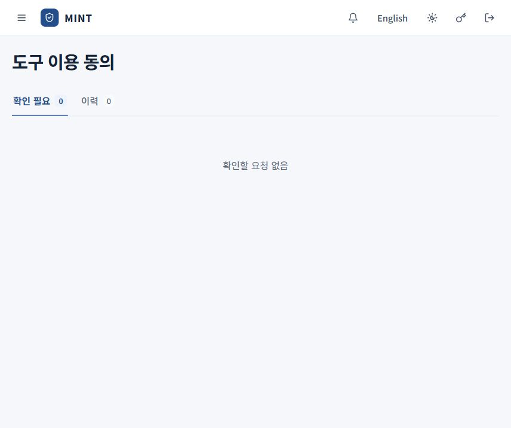

# 직원 사용 안내

[안내서 홈](README.md) · [처음 시작하기](getting-started.md) · [호출 기록 읽기](call-records.md)

직원과 협력업체 직원은 자신의 호출 기록, 도구 이용 동의, MCP 도입 신청을 확인합니다. 조직 전체의 계정·정책·종료 처리는 관리자 화면에서 다룹니다.

## 사용할 수 있는 MCP 찾기

**도입 신청 → 사용 가능한 MCP**에서 이름이나 기능으로 검색하고 **이용 방법**을 엽니다.

| 확인 항목 | 의미 |
| --- | --- |
| 사용 목적 | 승인된 업무 용도입니다. |
| 실행 방식 | 원격 서버 또는 엔드포인트에서 실행하는 MCP인지 표시합니다. |
| 제공 도구 | 사용할 도구, 허용 행위와 범위 심사 여부를 확인합니다. |
| 사용 기한 | 승인이 유효한 기한입니다. |
| MCP 주소 | 원격 연결의 게이트웨이 주소입니다. 표시되는 경우 복사할 수 있습니다. |
| 출처 | 소스 주소와 고정 커밋, 제공되는 경우 소스 다운로드를 확인합니다. |

승인된 서버만 관리형 설정에 배포됩니다. 주소를 복사하는 것만으로 사용할 권한이 생기지는 않습니다. **엔드포인트 실행으로 재승인 필요**가 표시되면 관리자에게 실행 방식의 재심사를 요청합니다.

## 도구 이용 동의

촬영 시점에는 확인할 요청이 없는 상태입니다. 요청이 생기면 이 화면에서 조건을 확인하고 처리합니다. 관리자 계정으로 촬영한 화면으로, 직원 계정에서는 역할에 따른 메뉴가 표시됩니다.

**도구 이용 동의 → 확인 필요**에서 도구별로 다음 내용을 읽습니다.

- 도구 이름과 데이터 등급
- 사용 목적과 입력 항목
- 외부 목적지

이용하려면 **동의**, 동의하지 않으면 **거부**를 선택합니다. 서버의 여러 요청을 한 번에 처리할 때는 **모두 허용** 또는 **모두 거부**를 누르고 확인 창의 도구 수·목적지·등급을 확인합니다.

**이력**에서는 동의 상태와 기한을 확인하고, 동의한 항목을 **철회**할 수 있습니다. 거부·철회한 항목은 화면에서 다시 동의할 수 있습니다. 동의는 표시된 이용 조건에 대한 것으로, 조직의 승인 범위와 호출 정책도 함께 충족해야 합니다.

## AI 코딩 에이전트에서 사용

PC 키트 설치와 활성화를 마친 뒤 관리형 설정이 적용된 Claude Code 또는 Codex CLI를 사용합니다. MINT는 게이트웨이를 지나는 호출을 실행 전에 판정하고, 호출의 실행 여부와 응답 처리 결과를 기록합니다.

| 결과 | 직원이 할 일 |
| --- | --- |
| 허용·응답 반환 | 업무 결과를 확인합니다. |
| 제한 실행·마스킹 반환 | 가려진 정보와 사용할 수 있는 결과를 확인합니다. |
| 승인 대기 | 관리자에게 해당 호출 기록을 전달하고 검토를 기다립니다. |
| 차단 | 호출 상세의 사유와 적용 정책을 확인합니다. |
| 응답 보류·실행 미확인 | 실제 도구 실행 여부를 먼저 확인합니다. 쓰기·실행 작업은 결과를 확인하기 전에 반복하지 않습니다. |

**승인 대기** 요청은 관리자의 **승인·실행**으로 실제 실행될 수 있습니다. 승인을 받았다는 이유만으로 같은 쓰기 작업을 다시 요청하면 중복 처리될 수 있으므로, [호출 기록](call-records.md)을 먼저 확인합니다.

## 필요한 MCP 신청

**도입 신청 → 새 신청**에서 서비스 이름, 사용 목적, 연결 정보와 데이터 등급을 입력합니다. 원격 MCP는 **도구 불러오기**로 사용할 도구를 선택합니다. 소스 기반 MCP는 공개 저장소 정보를 제출합니다.

신청 후 **내 신청**에서 상태를 확인합니다. 검증 완료는 관리자의 도입 승인과 별개입니다. 입력 항목과 검토 흐름은 [MCP 도입과 연결 관리](mcp-onboarding.md)를 봅니다.

## 승인 소스 받기

**사용 가능한 MCP → 이용 방법 → 출처**에 **소스 받기**가 표시되면 승인된 커밋의 소스를 받을 수 있습니다. Windows·Linux에서는 `mint sources`와 로컬 화면으로도 받습니다.

소스를 내려받는 권한과 MCP 실행 승인은 별개입니다. 승인된 로컬 실행은 엔드포인트가 매니페스트·소스·의존성 준비 정보를 확인한 뒤 진행합니다. 지원하지 않는 플랫폼이나 확인할 수 없는 구성에서는 실행이 거부될 수 있습니다.

## Windows·Linux에서 빠르게 확인하기

| 명령 | 기능 |
| --- | --- |
| `mint` | 상태 화면 열기 |
| `mint --check` | 연결 한 번 점검 |
| `mint servers` | MCP 서버, 커넥터와 하네스 기능 확인 |
| `mint logs` | 이 PC의 호출 목록 확인 |
| `mint logs 1` | 목록의 첫 번째 호출 상세 확인 |
| `mint requests` | 내 도입 요청과 신청 상태 확인 |
| `mint request <서버> --purpose "사용 목적"` | 관리자에게 도입 검토 요청 |
| `mint sources` | 받을 수 있는 승인 소스 확인 |
| `mint ui` | 이 PC의 로컬 화면 열기 |
| `mint console` | 웹 콘솔 열기 |

`mint request`의 목적은 10~1000자로 작성하며, 필요한 경우 `--source <HTTPS 주소>`를 붙입니다. PC에서 보낸 요청은 관리자가 **도입 관리 → 엔드포인트 요청**에서 확인하고 신청서 작성으로 이어갈 수 있습니다.

로컬 화면에서 도구 이용 동의를 대신 처리하지는 않습니다. 동의는 로그인한 웹 콘솔에서 합니다. 서비스별 계정 연결 화면도 제공하지 않으므로 필요한 서비스 자격은 관리자에게 요청합니다.

## 내 계정과 PC 정리

비밀번호는 콘솔 상단 **비밀번호 변경**에서 바꿉니다. PC 교체나 키트 제거 시에는 관리자에게 **엔드포인트 등록 해제**도 요청합니다. PC에서 파일이나 키트만 지워서는 서버의 장치 자격이 철회되지 않습니다. [제거와 재설치](../../endpoint-agent/README.md#제거와-재설치)를 따릅니다.
