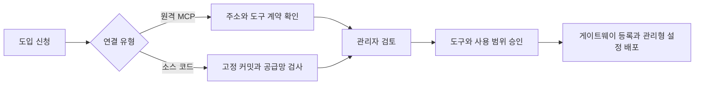
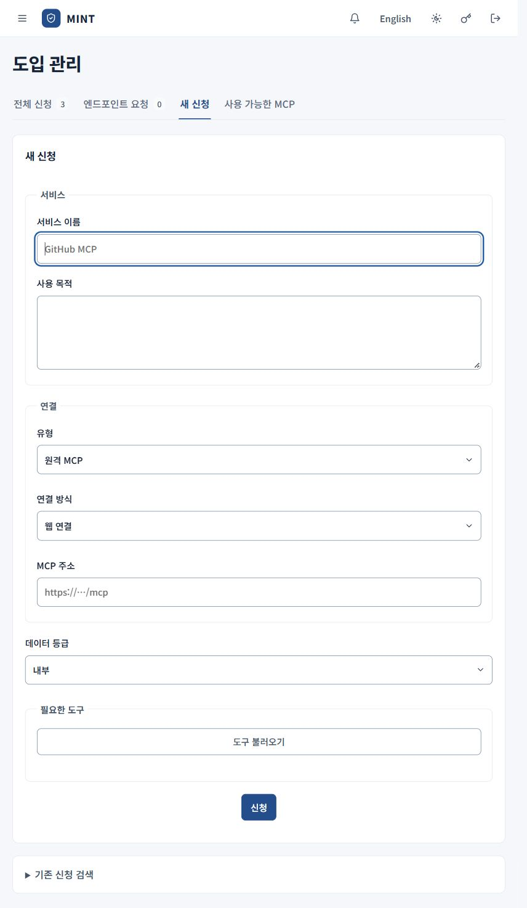
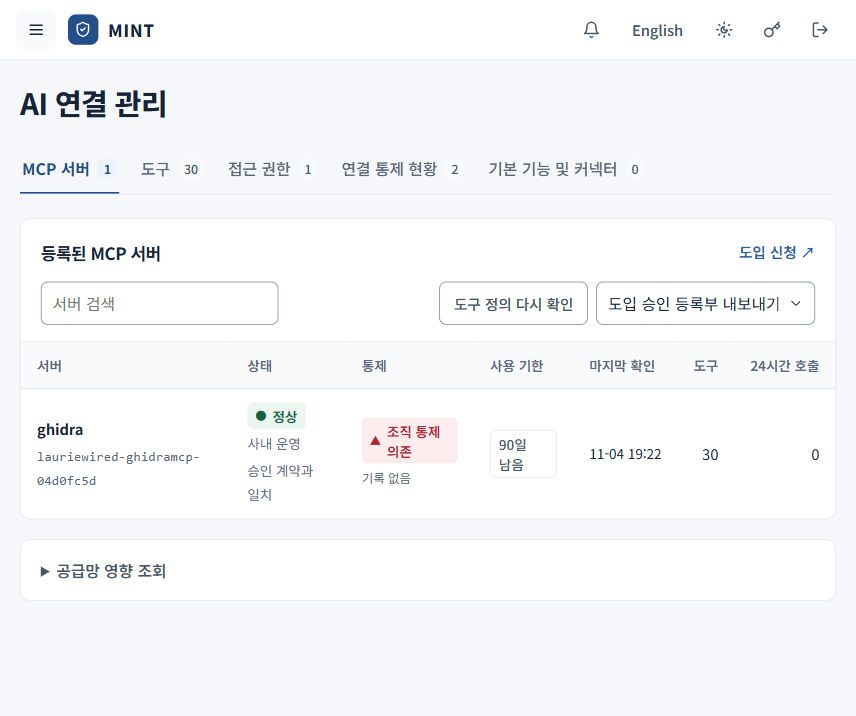

# MCP 도입과 연결 관리

[안내서 홈](README.md) · [직원 사용 안내](employee.md) · [관리자 운영 안내](administrator.md)

도입 과정에서는 서버의 출처와 도구 정의를 확인하고, 허용 도구·행위·사용 대상·기한을 정합니다. 직원의 신청과 관리자의 검토를 거쳐 승인된 연결을 사용합니다.

## 신청자가 하는 일

관리자의 **도입 관리 → 새 신청** 화면입니다. 직원은 **도입 신청**에서 같은 신청 항목을 작성합니다.

직원은 **도입 신청 → 새 신청**, 관리자는 **도입 관리 → 새 신청**을 엽니다.

| 항목 | 작성할 내용 |
| --- | --- |
| 서비스 이름 | 조직에서 구분할 수 있는 이름. 2~80자 |
| 사용 목적 | 어떤 업무에 어떤 자료와 도구가 필요한지. 10~1000자 |
| 유형 | **원격 MCP** 또는 **소스 코드** |
| 연결 방식 | 웹 연결, 이벤트 스트림, 프로세스 연결 중 서버에 맞는 방식 |
| 데이터 등급 | 공개·내부·중요 중 실제 업무에 맞는 등급 |
| 연결 정보 | 원격 MCP의 HTTPS 주소 또는 소스 코드의 공개 GitHub 저장소 주소 |

### 원격 MCP

1. 유형을 **원격 MCP**로 선택하고 제공자가 안내한 MCP 주소를 입력합니다.
2. **도구 불러오기**를 눌러 제공 도구를 확인합니다.
3. 업무에 필요한 도구를 선택하고 신청합니다.

웹사이트 첫 화면 주소와 MCP 접속 주소는 다를 수 있습니다. 도구 조회가 실패하면 주소·연결 방식과 서비스 자격이 필요한지 관리자에게 확인합니다. 비밀번호나 토큰을 사용 목적이나 URL에 적지 않습니다.

### 소스 코드

유형을 **소스 코드**로 선택하고 공개 GitHub 저장소를 입력합니다. 제출 후 고정된 커밋과 검사 결과를 기준으로 검토합니다. 실제 실행에 필요한 엔드포인트의 런타임·파일·의존성·이미지 정보는 관리자가 검토 과정에서 확인합니다.

### 진행 상태 읽기

| 상태 | 의미와 다음 단계 |
| --- | --- |
| 검토 대기 | 검토 내용과 보류 사유를 확인합니다. |
| 검증 대기 / 검증 중 | 검사 진행을 기다립니다. |
| 검증 완료 | 소스 검사 결과가 준비되었습니다. 도입 승인 여부는 별도로 확인합니다. |
| 계약 검토 완료 | 원격 MCP의 계약 검토 정보가 준비되었습니다. 승인·등록 여부를 확인합니다. |
| 승인 | 사용 대상과 기한, 등록 상태를 확인합니다. |
| 검증 실패 | 실패한 검사기와 오류를 확인해 보완합니다. |
| 거부 | 검토 결과를 확인하고 필요한 변경을 관리자와 협의합니다. |

Windows·Linux의 `mint request`로 제출한 요청은 관리자의 **엔드포인트 요청**에 모입니다. 관리자는 **신청서 작성**으로 정식 도입 신청을 이어가거나 **검토 종료**로 요청을 닫습니다. 요청을 닫는 것만으로 서버가 승인되지는 않습니다.

## 관리자가 검토하는 일

### 1. 보고서 읽기

**도입 관리 → 전체 신청 → 보고서**를 엽니다.

| 유형 | 중점적으로 볼 항목 |
| --- | --- |
| 원격 MCP | 계약·범위, 허용 인자, 영향평가, 출처, 승인 기록, 승인 도구 계약 |
| 소스 코드 | 요약, 검사 단계와 기준, 취약점·코드 검사, 비밀 정보 검사, SBOM, 종료 조건, 범위, 영향평가, 출처, 승인 기록 |

소스 기반 보고서에서는 Syft의 구성요소 목록과 Trivy·Semgrep·Gitleaks 등의 검사 결과를 확인할 수 있습니다. 완료 여부, 오류와 고정 커밋을 함께 확인합니다. 표시 목록이 잘린 경우 제공되는 원본 보고서도 확인합니다. 소스 검사와 원격 서버의 계약 확인은 검사 범위가 다르며, 원격 MCP를 등록했다고 제공자의 내부 소스까지 검사한 것은 아닙니다.

소스 보고서는 **보고서 JSON 저장**과 원본 보고서 다운로드를 제공합니다. **검증 실패**나 보완이 필요한 소스 신청은 사유를 확인한 뒤 가능한 경우 **재검증**을 진행합니다.

### 2. 승인 범위 정하기

**전체 신청**의 **검토**를 열고 다음을 확인합니다.

- 서버 주소·고정 판본·출처와 계약 지문
- 승인할 도구, 도구별 허용 행위와 인자 제한
- 외부 주소를 받는 도구의 허용 주소
- 데이터 등급, 영향평가와 위험 등급
- 사용 기한과 **전체 직원 / 신청자만 / 지정 직원** 중 사용 대상
- 제공자 정보, 지원 종료, 데이터 처리·저장 위치와 종료 조건 등 필요한 추가 정보

소스 기반 신청에 **엔드포인트 실행** 설정이 필요하면 프로세스·컨테이너 방식, 런타임·진입 파일·의존성 잠금 정보 또는 이미지, 실행 인자와 폴더, 실행 위치 근거를 검토합니다. 실행 환경 정보가 확인되지 않거나 승인 차단 사유가 있으면 보완한 뒤 진행합니다.

### 3. 독립 승인과 등록 결과 확인

기본은 신청자와 다른 관리자가 승인합니다. 위험 등급이 **높음** 또는 **매우 높음**인 경우 2인 승인 절차가 적용됩니다. 필요한 위험 수용 사유를 작성하고 화면에 표시되는 승인 단계와 최종 등록 결과를 확인합니다.

배포 설정으로 최고 관리자 `root`의 단독 운영을 명시적으로 켠 환경에는 승인 예외가 있으며 해당 사실을 기록합니다. 운영 방식은 [서버 설정](../../deploy/README.md)에서 확인합니다. 이 예외는 명시적으로 설정된 최고 관리자에 한하며, 단독 운영 승인을 독립 승인으로 기록하지 않습니다.

승인 후 **AI 연결 관리 → MCP 서버**에서 서버 상태와 등록 정보를 확인합니다. 직원은 **도입 신청 → 사용 가능한 MCP**에서 자신의 사용 대상에 포함된 서버를 확인합니다. 등록과 PC 설정 배포 이후에도 도구 이용 동의·호출 정책·엔드포인트 상태가 충족되어야 사용할 수 있습니다.

## 승인된 연결 관리

등록된 MCP 서버의 상태·통제·사용 기한을 확인하는 화면입니다. 표시된 서버와 수치는 촬영 시점의 예입니다.

### MCP 서버·도구·접근 권한

**AI 연결 관리**의 다음 탭을 사용합니다.

| 탭 | 확인·조작하는 일 |
| --- | --- |
| MCP 서버 | 등록 정보, 정상·계약 변경·연결 오류 상태, 사용 기한, 최근 확인과 호출 수 |
| 도구 | 도구별 행위, 승인 여부와 계약 일치 상태 |
| 접근 권한 | 사용자·서버·행위·자원·도구·만료 시각의 허용 범위 조회 |
| 연결 통제 현황 | 연결 유형별 통제 상태, 승인 상태와 우회 경로 |
| 기본 기능 및 커넥터 | 기본 기능 차단, 커넥터 전체·개별 통제와 추가 연결 승인 관리 |

서버 행을 열면 **연결 확인**, **사용 대상**, 필요한 경우 **범위 심사**·**위치 심사** 등의 조작이 표시됩니다. **사용 대상**을 바꾸면 해당 서버를 사용할 대상이 바뀝니다. 범위 심사는 도구별 역할과 데이터 범위를 검토하는 일입니다. 접근 권한 탭은 조회 화면이며 임의의 권한 편집 화면으로 사용하지 않습니다.

**도구 정의 다시 확인**으로 현재 도구 계약을 다시 확인할 수 있습니다. 계약 변경이 발견되면 변경 내용을 검토하고 필요한 재심사를 진행합니다. 최초 도구 정의를 관찰했다는 이유만으로 자동 승인되는 것은 아닙니다.

**도입 승인 등록부 내보내기**에서 CSV 또는 JSON을 선택해 승인 등록부를 보관할 수 있습니다. 서버 이용을 영구적으로 종료할 때는 단순 **등록 해제**와 [종료 및 폐기](termination.md)의 회수·증거 절차를 구분합니다.

### 기본 기능과 커넥터

**기본 기능 및 커넥터**에서는 보고된 하네스 기능과 커넥터를 확인하고 표시되는 **차단**, **승인**, **차단 해제**, **승인 취소**를 사용합니다. **커넥터 설정 내보내기**로 현재 설정을 받을 수 있습니다.

**승인 · 기록만**은 승인 사실의 기록을 뜻합니다. 게이트웨이 호출 전 검사가 모든 벤더 기능에 적용된다는 뜻은 아닙니다. **통제 적용 상태**와 **벤더 콘솔** 상태를 따로 확인하고, 필요한 벤더·엔드포인트 설정을 적용합니다.

서비스에 접근할 자격이 필요한 경우 [운영자 원격 MCP 자격 설정](../../deploy/README.md#운영자-원격-mcp-자격-파일)을 확인합니다. 현 판본에는 직원이 서비스 계정을 직접 연결하는 콘솔 화면이 없습니다.
