# 화면으로 둘러보기

[안내서 홈](README.md)

실행 중인 MINT `1.0.0` 콘솔을 2026-11-05에 라이트 모드로 캡처했습니다. 로그인한 역할과 조직 설정, 등록된 서버, 브라우저 너비에 따라 메뉴와 내용이 달라집니다. 수치와 빈 목록은 촬영 시점의 실제 조회 결과입니다.

## 로그인

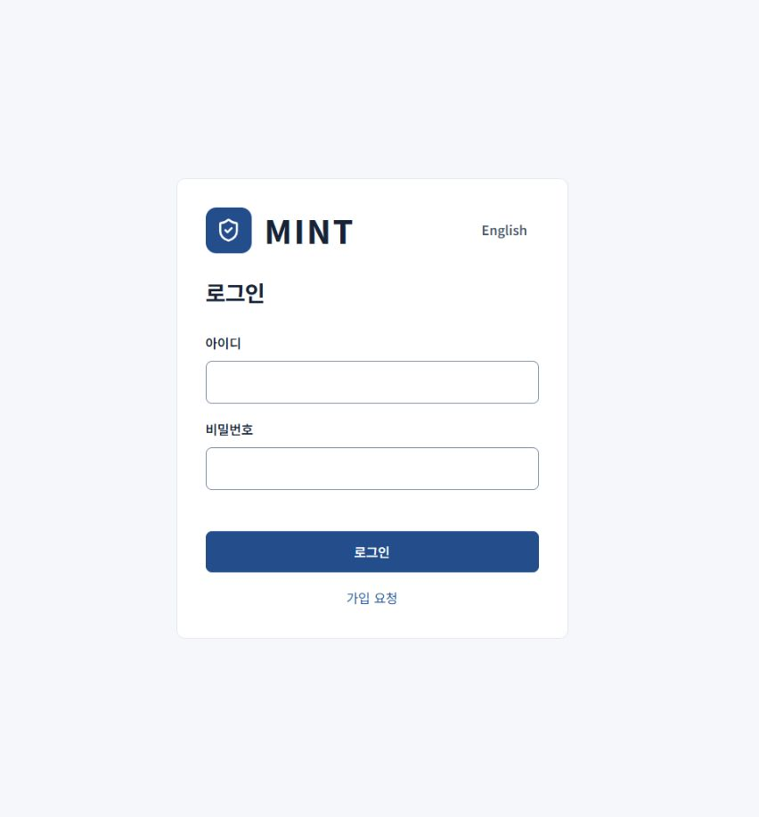

계정 준비와 PC 연결의 시작 화면입니다. [사용 안내](getting-started.md)

## 콘솔 메뉴

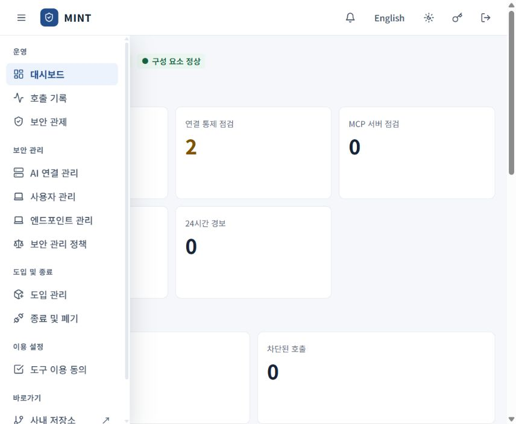

메뉴를 펼친 화면입니다. 브라우저 너비에 따라 메뉴가 본문 위에 열립니다. [사용 안내](README.md)

## 관리자 대시보드

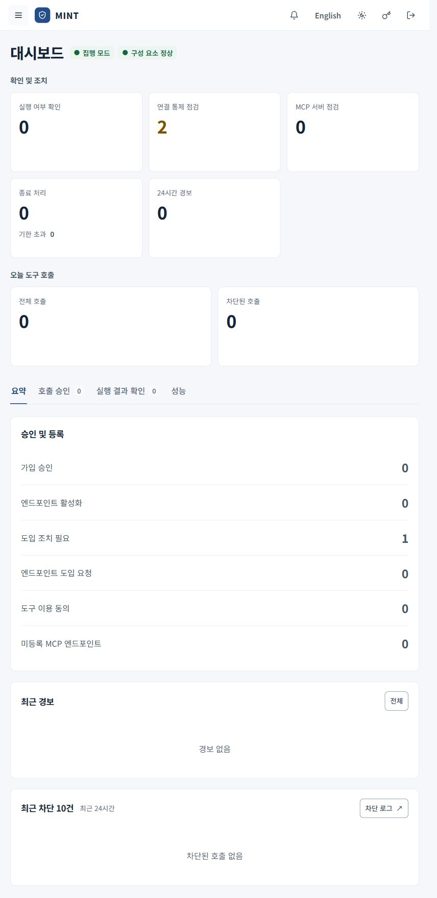

처리할 일과 호출 현황을 모아 확인합니다. [사용 안내](administrator.md)

## MCP 도입 신청

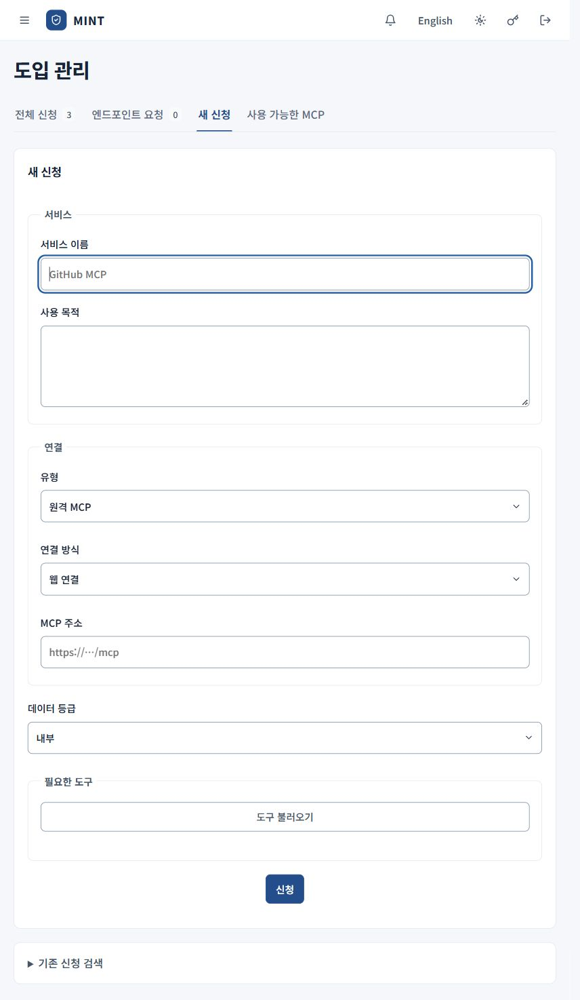

관리자의 새 신청 화면입니다. 직원에게는 도입 신청 메뉴가 표시됩니다. [사용 안내](mcp-onboarding.md)

## AI 연결 관리

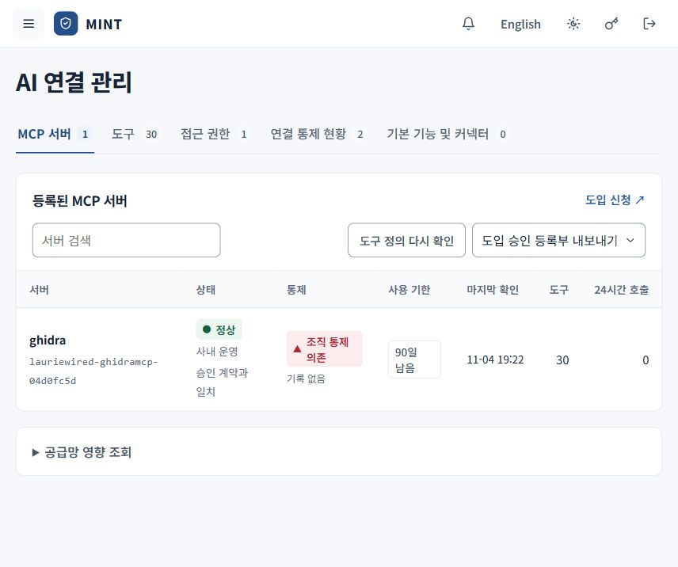

등록된 서버의 상태, 통제와 사용 기한을 확인합니다. [사용 안내](mcp-onboarding.md)

## 호출 기록

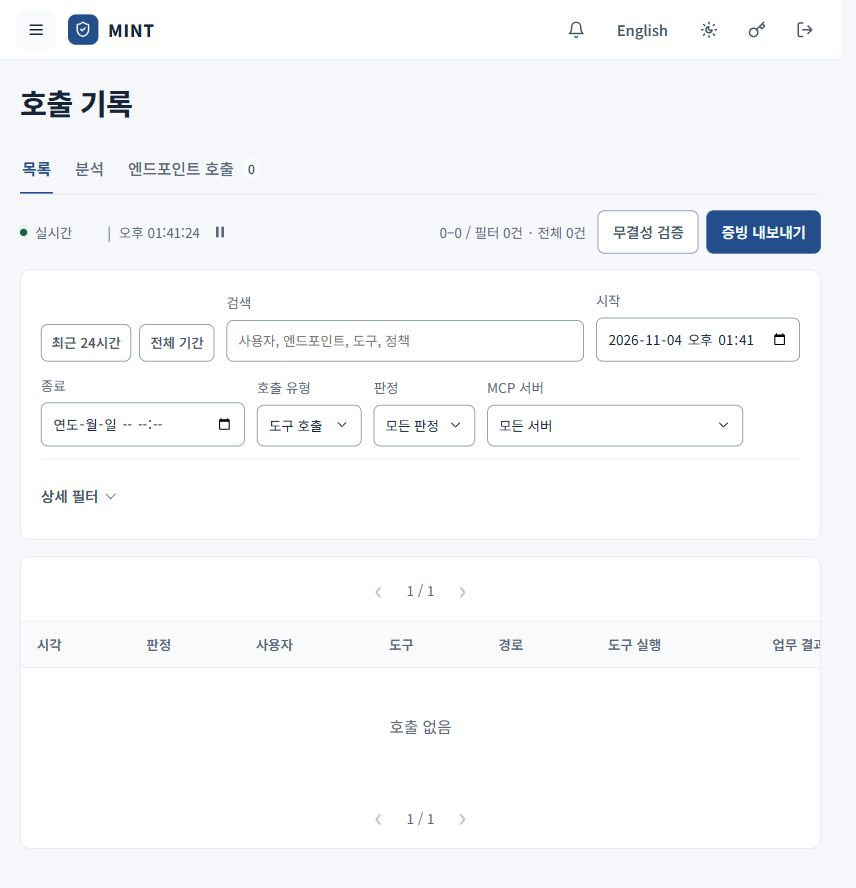

관리자 조회 화면입니다. 촬영 시점의 최근 24시간 조회 결과는 0건입니다. [사용 안내](call-records.md)

## 도구 이용 동의

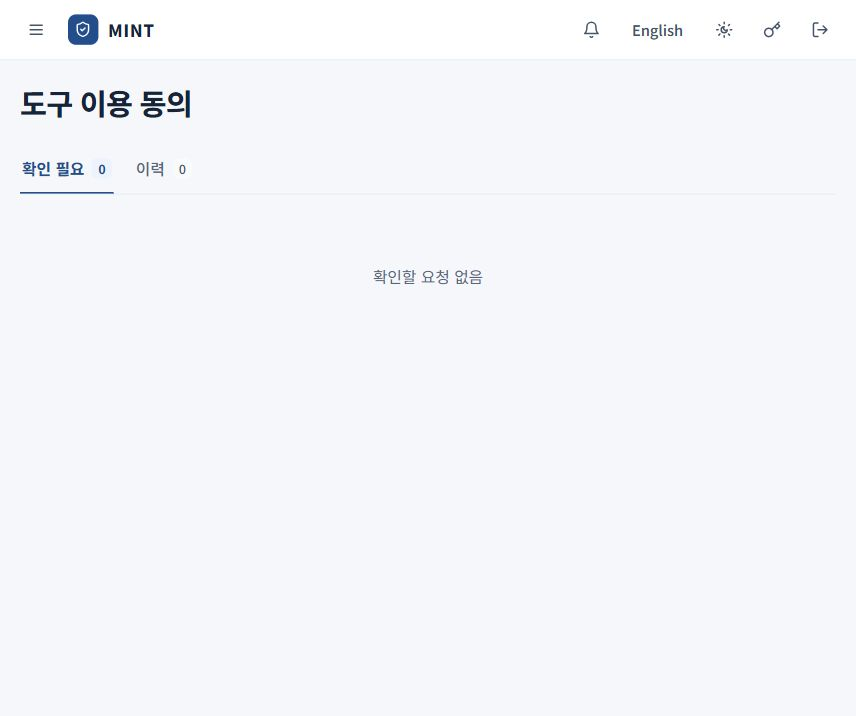

촬영 시점에는 확인할 요청이 없는 상태입니다. 관리자 계정으로 촬영했습니다. [사용 안내](employee.md)

## 엔드포인트 관리

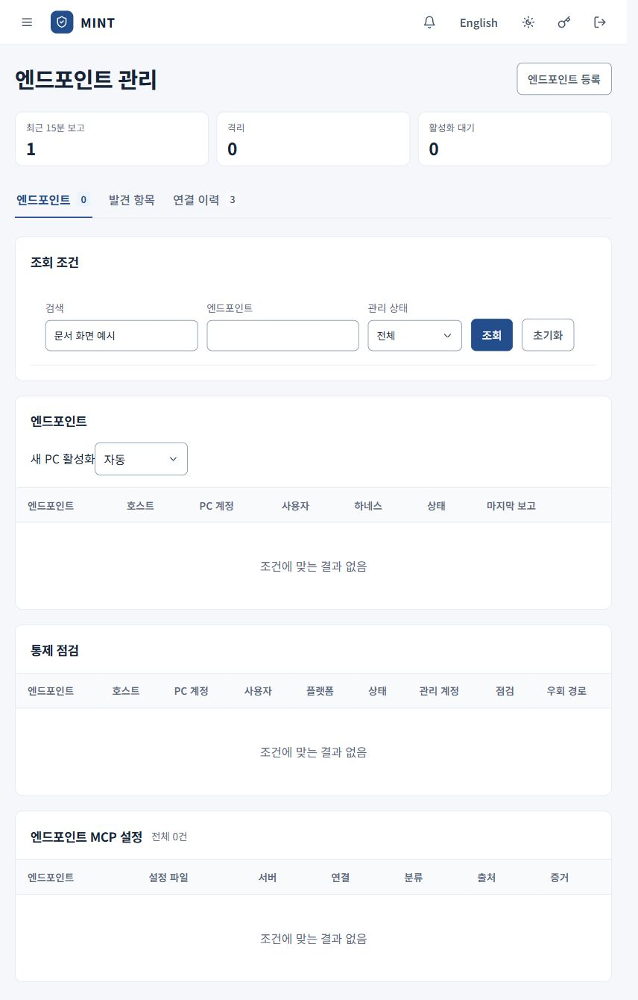

기기 식별정보를 노출하지 않도록 검색 조건을 적용했습니다. 목록의 0건은 검색 결과입니다. [사용 안내](administrator.md)

## 보안 관제

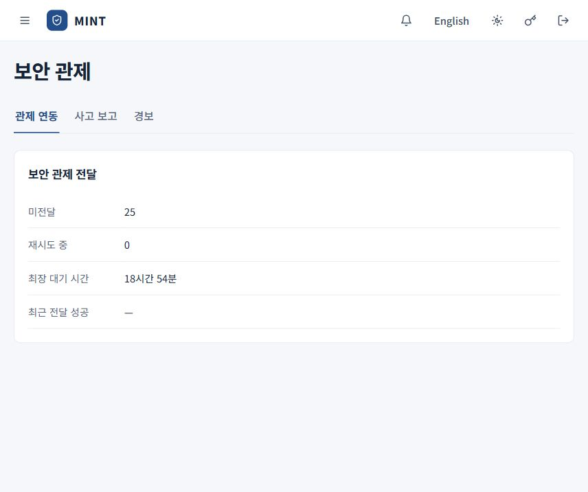

관제 전달 대기 상태입니다. 화면의 수치가 연동 성공을 뜻하지는 않습니다. [사용 안내](security-operations.md)

## 보안 관리 정책

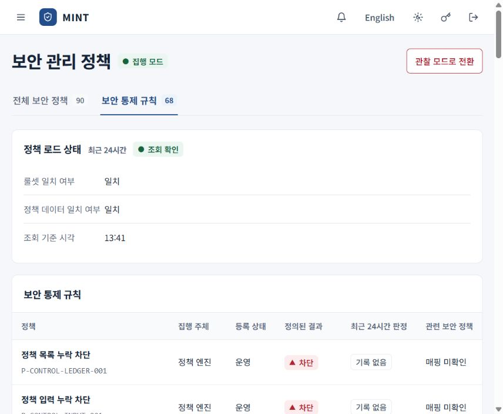

정책 로드 상태와 통제 규칙 목록 상단입니다. [사용 안내](security-operations.md)

## 종료 및 폐기

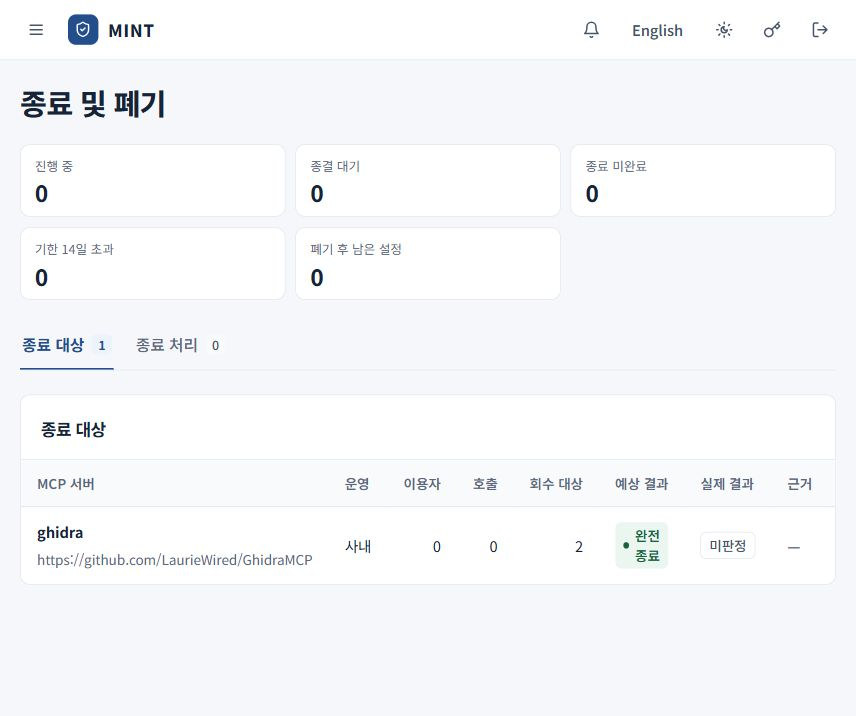

종료 시작 전의 대상 요약입니다. 실제 종료나 회수 작업은 실행하지 않았습니다. [사용 안내](termination.md)
