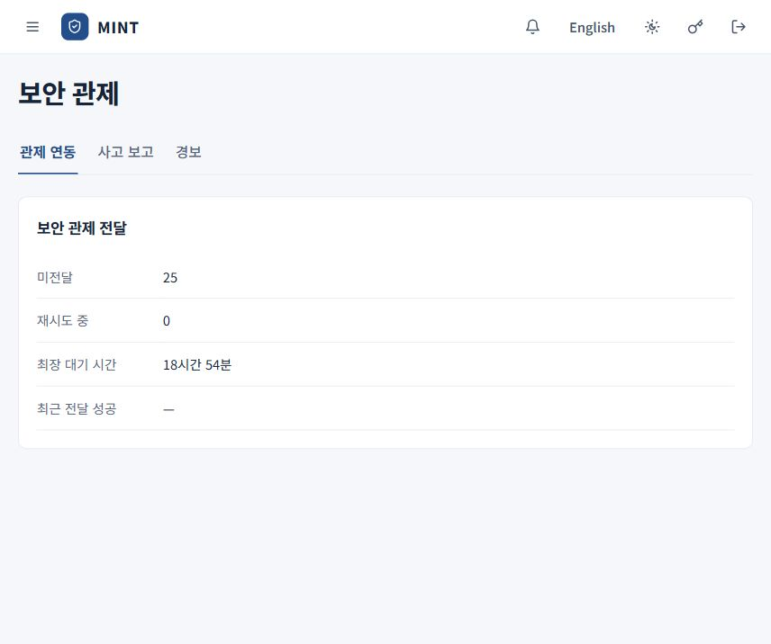
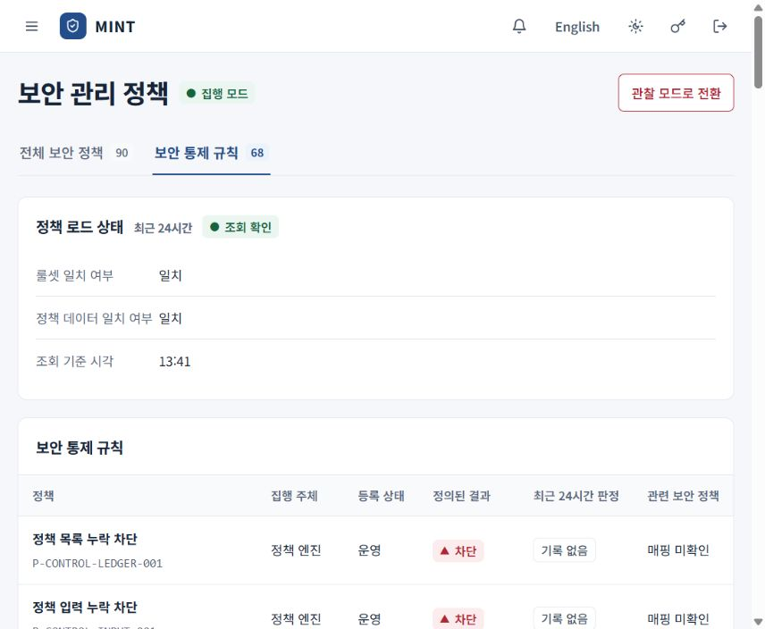

# 보안 관제와 정책 확인

[안내서 홈](README.md) · [호출 기록과 감사 증빙](call-records.md) · [종료 및 폐기](termination.md)

관리자는 경보의 원인과 실제 실행 결과를 확인한 뒤, 관련 사용자·서버·PC의 범위에 맞게 조치합니다. 경보 확인, 정책 상태 조회와 실제 통제 적용을 구분합니다.

## 경보에서 관련 대상까지 확인

**보안 관제 → 경보** 또는 상단 경보 아이콘을 엽니다.

1. 경보 종류·발생 시각·대상을 확인합니다.
2. 경보 행을 열어 상세 사유와 실행 여부를 확인합니다.
3. **대상 보기** 또는 **미등록 MCP 보기**로 관련 화면에 이동합니다.
4. 호출 번호·추적 ID·엔드포인트·서버를 기준으로 [호출 기록](call-records.md)과 연관 이벤트를 대조합니다.
5. 필요한 조치 후 서버 상태·PC 보고·후속 호출을 다시 확인합니다.

| 확인한 문제 | 이어서 볼 곳 |
| --- | --- |
| 승인되지 않은 MCP 설정·사용 | 엔드포인트 관리 → 발견 항목 |
| 도구 계약 변경·새 도구 | AI 연결 관리 → MCP 서버·도구, 도입 관리의 보고서 |
| 사용자 또는 서버별 이용 문제 | 사용자 관리 → 사용자·이용 중지, AI 연결 관리의 사용 대상 |
| 정책 로드·판정 문제 | 보안 관리 정책 → 보안 통제 규칙 |
| 종료 처리 지연·남은 설정 | 종료 및 폐기 → 종료 처리 |

경보를 열어 읽은 것과 원인을 해소한 것은 별개입니다. 예를 들어 미등록 설정이 발견되면 도입 검토가 필요한지, 제거해야 하는지 판단한 뒤 실제 설정과 통제 상태를 확인합니다.

## 연결 통제 상태 읽기

**AI 연결 관리 → 연결 통제 현황**에서 연결 유형·상태·이름으로 조회하고 항목 상세를 엽니다.

| 표시 | 운영상 의미 |
| --- | --- |
| 게이트웨이 통제 | 해당 연결의 게이트웨이 경로에 통제가 적용됩니다. |
| 엔드포인트 통제 | 엔드포인트의 관리 설정과 제한에 의존합니다. 보고 시점과 점검을 확인합니다. |
| 벤더 통제 | 벤더 측 설정에 의존합니다. 벤더 콘솔 상태와 근거를 확인합니다. |
| 관찰만 | 관찰된 항목이며 강제 차단이 확인된 상태로 해석하지 않습니다. |
| 엔드포인트 미등록 | PC 등록과 보고 상태부터 확인합니다. |
| 조직 통제 의존 | 별도 PC·네트워크·벤더 통제가 필요한 우회 경로 등을 확인합니다. |

한 항목을 승인했다고 모든 연결 경로가 통제되는 것은 아닙니다. **승인 상태**, **통제 적용 상태**, **우회 경로**를 함께 확인합니다.

## 공급망 취약점의 영향 조회

**AI 연결 관리 → MCP 서버**에서 **공급망 영향 조회**를 펼칩니다.

1. 패키지 이름과 **판본 범위**를 입력합니다. 예를 들어 `>=1.2.0 <2.0.0`처럼 조회할 범위를 지정합니다.
2. **조회**를 눌러 **영향 있음 / 영향 없음 / 판단 불가 / 자료 없음**의 건수를 확인합니다.
3. 중지가 필요하면 조회 범위를 재확인하고 **영향 서버 중지**를 선택한 뒤 사유를 입력합니다.
4. 완료 메시지의 성공·건너뜀·실패 건수와 실제 서버 상태를 확인합니다.

이 조회는 보유한 SBOM 등 자료를 기준으로 합니다. **자료 없음**이나 **판단 불가**는 안전하다는 뜻이 아닙니다. 영향 서버 중지는 실제 이용을 막는 조작이며, 종료 증거 수집까지 대신하지는 않습니다. 영구 종료는 [종료 및 폐기](termination.md)를 따릅니다.

## 관제 연동 상태

전달 대기와 최근 성공 상태를 보여 줍니다. 화면의 건수·대기 시간은 촬영 시점의 값이며, 연동이 완료되었다는 예시는 아닙니다.

**보안 관제 → 관제 연동**에서 미전달 건수, 재시도 중 건수, 최장 대기 시간과 최근 전달 성공 시각을 확인합니다.

외부 관제 전달은 선택 기능입니다. 서버에서 수신 주소·자격·인증서를 설정하고 워커를 실행해야 합니다. 콘솔에 대기열 상태가 보이는 것만으로 외부 관제 시스템에 도착했다고 판단하지 않습니다. 설정과 기동은 [서버 운영 설정](../../deploy/README.md)을 따릅니다.

미전달이 늘면 운영자는 수신 서비스의 가용성, 자격 파일, 인증서와 워커 로그를 확인합니다. 원장의 기록 상태와 외부 전송 성공 상태는 따로 확인합니다.

## 사고 보고 증빙

**보안 관제 → 사고 보고**에서 등록된 사고의 관할·단계·기한·남은 시간·상태를 확인합니다. 사고 행을 열면 영향 호출의 포함·조회 건수, 해시 사슬과 패키지 검증 결과를 확인할 수 있습니다.

이 화면의 기한과 증빙 조회는 외부 기관에 신고가 제출되었다는 의미가 아닙니다. 실제 보고 대상·기한·제출은 조직의 사고 대응 절차에 따라 별도로 확인합니다.

## 보안 관리 정책

정책 로드 상태와 통제 규칙 목록의 상단입니다. 실제 모드 전환 없이 조회한 화면입니다.

### 전체 보안 정책

**보안 관리 정책 → 전체 보안 정책**에서 정책 대상, 적용 단계, 구현 방식과 코드 확인을 봅니다. **조직 적용 확인**의 **미확인**을 실제 조직 적용 완료로 해석하지 않습니다.

### 보안 통제 규칙

**보안 통제 규칙**에서 다음을 확인합니다.

- 정책 원본의 조회 상태와 기준 시각
- 룰셋 일치 여부와 정책 데이터 일치 여부
- 정책별 집행 주체·등록 상태·정의된 결과
- 최근 24시간 판정 기록과 관련 보안 정책

규칙 행을 열면 상세를 확인합니다. **기록 없음**은 해당 기간의 기록 유무이며 규칙이 작동하지 않는다는 단정은 아닙니다. 이 화면은 정책 확인용이며 모든 정책 내용을 편집하는 화면은 아닙니다.

### 집행 모드와 관찰 모드

상단에서 현재 모드를 확인하고 **관찰 모드로 전환** 또는 **집행 모드로 전환**을 사용할 수 있습니다. 관찰 모드는 정책의 예상 판정을 기록하는 데 사용하며, 모든 보안 검사와 안전 차단을 끄는 기능이 아닙니다. 차단 동작이 달라질 수 있으므로 조직의 변경 절차에 따라 전환하고, 이후 호출의 실제 판정과 실행 결과를 확인합니다.

정책 조회 실패나 배포 불일치가 있으면 운영자가 서버 상태와 정책 로드를 먼저 점검합니다. 규칙·정책 코드의 위치는 [보안 정책](../../policy/README.md)에 있습니다.
