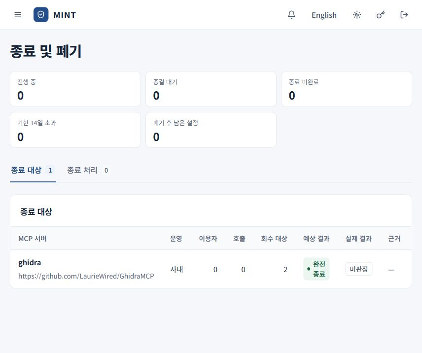

# 종료 및 폐기

[안내서 홈](README.md) · [관리자 운영 안내](administrator.md) · [호출 기록과 감사 증빙](call-records.md)

MCP 이용 관계를 끝낼 때 호출 경로를 차단하고, 회수할 자격과 설정을 열거하며, 수집한 증거로 종료 결과를 판정합니다. 서버 연결이 끊겼다는 사실과 제공자·엔드포인트의 자격 회수가 끝났다는 사실을 구분합니다.

## 1. 종료할 이용 관계 확인

종료를 시작하기 전의 대상 요약입니다. **예상 결과**와 **실제 결과**를 구분하며, 캡처를 위해 종료를 실행하지 않았습니다.

**종료 및 폐기 → 종료 대상**에서 서버, 이용 목적, 운영 주체, 이용자·호출·회수 대상 수와 예상 결과를 확인합니다. 행을 열어 허용 자원, 회수 대상과 종료 조건을 검토합니다.

종료 단위는 조직·목적·제공자·허용 자원으로 정해지는 이용 관계입니다. 비슷한 이름의 서버나 다른 목적의 관계와 혼동하지 않도록 상세를 확인합니다. **예상 결과**는 준비 상태를 바탕으로 한 값이며 실제 증거 수집 뒤의 판정과 다를 수 있습니다.

## 2. 종료 시작

**종료 시작**을 누르고 10~1000자의 종료 사유를 작성한 뒤 **차단하고 종료 시작**을 선택합니다.

이 조작은 해당 MCP 서버의 호출을 즉시 차단하고 종료 처리를 엽니다. 이미 실행된 작업의 효과를 되돌리는 조작은 아닙니다. 완료 화면에서 차단 시각과 회수 대상 수를 확인합니다.

진행 상황은 **종료 처리** 탭에서 확인합니다. **조치 필요**, **기한 초과**로 조회할 수 있으며, 상세 상단에 이용 관계 확정부터 종결까지의 단계가 표시됩니다.

## 3. 회수 대상과 상태 정리

상세의 **회수 대상**에서 종류, 보유 주체, 발견 경로와 상태를 확인합니다.

| 상태 | 할 일 |
| --- | --- |
| 미회수 | 자격이나 설정의 회수 조치를 진행하고 상태 증거를 확보합니다. |
| 회수됨 | 대상·시점과 회수 결과를 확인할 증거를 연결합니다. |
| 만료 | 만료 시점과 실제 적용 범위를 확인합니다. |
| 확인 불가 | 대상 범위나 상태를 확인할 추가 자료를 확보합니다. |

빠진 대상은 **대상 추가**로 종류·이름·보유 주체·발견 경로를 남깁니다. **상태 기록**에서는 확인한 상태와 메모를 기록합니다. 상태를 회수됨으로 바꾸는 것만으로 실제 자격이 폐기되지는 않습니다.

지원하는 조직 보유 자격에 **조직 권한으로 폐기**가 표시되면 실제 폐기 조작을 할 수 있습니다. 이 버튼이 없는 제공자 자격 등은 담당 시스템에서 회수하고 그 결과 증거를 확보합니다.

## 4. 증거 수집과 등록

**증거 수집**에서 필요한 항목을 선택합니다.

| 항목 | 확인 범위 |
| --- | --- |
| 게이트웨이 차단 확인 | 조직의 게이트웨이 경로에서 호출이 거부되는지 |
| 엔드포인트 설정 대조 | 보고된 엔드포인트 설정에서 항목이 제거되었는지 |
| 하위 시스템 자격 확인 | 지원하는 하위 시스템에서 해당 자격이 남아 있는지 |
| 서버 도달 확인 | 해당 서버 주소가 응답하는지 |
| 세션 종료 요청 | 서버가 세션 종료 요청에 어떤 응답을 했는지 |

마지막 두 항목만으로 모든 자격이 폐기되었다고 판단하지 않습니다. 서버는 다른 고객에게 계속 서비스할 수 있고, 세션 종료 응답도 토큰 소멸을 모두 증명하지는 않습니다.

수동으로 받은 자료는 **증거 → 증거 등록**에서 종류, 대상, 식별자, 출처와 내용을 기록합니다. 제공자 증명은 대상과 시점이 구체적이어야 하며, 그 진술을 독립적으로 검증한 결과와 구분합니다.

## 5. 판정 읽기

**판정**을 누르면 대상별 기준과 전체 등급을 확인합니다.

| 기준 | 확인하는 내용 |
| --- | --- |
| 모집단 | 회수 대상을 열거하고 조치 대상과 대조했는가 |
| 수행 권한 | 조치 권한이 있고 필요한 증거를 확보할 수 있는가 |
| 연속성 | 조치부터 전파 완료까지 공백이 없는가 |
| 증거 접근 | 대상·시점의 상태를 확인할 수 있고 증거를 열람할 수 있는가 |

| 결과 | 의미 |
| --- | --- |
| 완전 종료 | 수집한 증거에 따라 대상의 네 기준이 모두 충족됩니다. |
| 부분 종료 | 대상과 상태 증거는 확인되지만 수행 권한 또는 연속성에 공백이 있습니다. |
| 종료 확인 불가 | 대상 범위나 상태 증거 같은 필수 근거를 확인하지 못했습니다. |

전체 결과에는 가장 낮은 대상 등급이 반영됩니다. **확인 및 조치**, 기준별 미충족 사유, **미회수 / 확인 불가 / 차단 후 실행 / 엔드포인트 잔존**을 함께 읽습니다. 근거가 달라지면 증거를 보완하고 재판정합니다.

## 6. 종결과 후속 확인

판정 후 **종결** 또는 **종결 검토**에서 종결 사유를 입력합니다. **종료 확인 불가** 결과를 종결할 때는 위험 수용 근거도 필요합니다. 종결했다고 부분 종료나 확인 불가가 완전 종료로 바뀌지는 않습니다.

- **판정서**에서 결과와 근거를 확인하고 JSON으로 보관합니다.
- 제공자 운영 서버의 **고지 요청서**는 요청할 자료를 정리하는 기능입니다. 제공자에게 자동으로 발송되는 것은 아닙니다.
- **종결 후 잔여 상태**에서 미회수·확인 불가·엔드포인트 잔존을 확인합니다.
- 추가 증거와 조치가 필요하면 사유를 적어 **종료 처리 재개** 후 보완합니다. 재개는 서버의 이용 재허용을 뜻하지 않습니다.

종료 결과는 수집·제출한 증거와 그 범위에 따른 판정입니다. 게이트웨이 밖의 모든 경로와 제공자의 실제 회수를 직접 검증했다는 보증으로 사용하지 않습니다.
